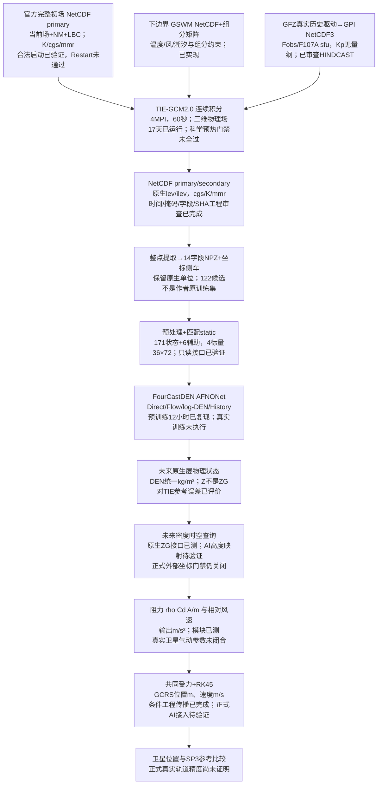

# 从初始场到卫星位置：本项目TIE-GCM—FourCastDEN端到端讲解

更新：2026-10-31。面向能读Python、正在学习热层与轨道动力学的读者。本文只解释已有实现和验证，不代表授权新实验。

先记住三句话：**TIE-GCM通过物理方程推进大气状态；FourCastDEN学习这种模拟状态的一小时演化；轨道模型再把卫星处的密度变成气动阻力。**目前前两者的工程链条已经建立，正式AI密度到真实卫星轨道精度验证仍未闭合。

## 1. 初始场：模型开始时，整个三维大气是什么样

### 1.1 它不是一条密度曲线

时间推进需要一个空间分布完整的起点。TIE-GCM完整primary包含各经纬度、各原生垂直层的温度、中性风、组分、离子/电子状态和电势，并保留部分积分历史。它不是只输入一个地表温度，也不是给450km设置一个常数密度。

本项目使用官方5°mareqx_smin和mareqx_smax完整初场。其原有2002年记录只是数值初猜；将START_YEAR设成2021不会使那条记录变成2021实测大气。模型在2021真实历史驱动下逐步调整，这正是为什么需要预热和初态敏感性比较。来源/完整性见`reports/TIEGCM_2021_INITIAL_STATE_AUDIT.md`，不凭文件名推断太阳条件相同或科学合格。

网格的地理中心为36纬×72经，原生lev/ilev各29个坐标位置。温度和水平风的最高存储位置存在padding/缺测约定，不能说每个存储值都有效。完整初场需包含模型要求的所有层和当前/历史变量，不能从FourCastDEN的171目标通道反拼完整重启场。

### 1.2 SOURCE实际读什么、怎么进入模型

实际入口是`third_party/TIEGCM2.0/src/tgcm.F:99–166`：读取namelist，设置网格/常数/apex与MPI/ESMF，初始化模型，再调用`readsource`，随后初始化磁场相关量与下边界，进入`advance`。

`rdsource.F:47–66`规定：提供SOURCE时，在源文件中找SOURCE_START；省略SOURCE时，在独立OUTPUT文件中找START，准备继续追加。原`input.F:948–960`要求显式SOURCE_START与START的小时/分钟相同，不能把任意记录重标成所需时刻。

本项目标准34项包括：

|类别|实际变量|作用|
|---|---|---|
|18个当前三维状态|TN、UN、VN、O2、O1、N4S、NO、HE、AR、OP、N2D、TI、TE、NE、O2P、OMEGA、Z、POTEN|动力、能量、化学、电动力的状态及耦合输入|
|10个历史状态|TN_NM、UN_NM、VN_NM、O2_NM、O1_NM、N4S_NM、NO_NM、OP_NM、HE_NM、AR_NM|双时间层推进与过滤后的历史记忆|
|6个下边界/历史场|TLBC、ULBC、VLBC及对应_NM|温度与风的下边界状态|

准确字段表是`src/atmosphere/restart_validation.py`及`fields.F`。MPI各rank只持有本地块，并恢复邻域halo。`itp/itc`是读/写存储槽，`_NM`才是独立的历史变量，不能把它们混为一谈。

### 1.3 初始场与Restart为什么不是一回事

初始场回答“给模型一个合法起点”；无损Restart还要求“继续运行与从未中断几乎相同”。完整primary是模型支持的标准恢复载体，但未存全部运行时内部磁势/电场数组。写出时磁格phim3d映射成地理POTEN，恢复时再反向映射；首步还会重算部分量。

本项目10+10分钟相对连续20分钟已实测恢复超差。因此可以从官方完整场合法启动连续积分，却不能默认任意中间primary都是无损运行时快照。详见`reports/TIEGCM_RESTART_FIRST_DIVERGENCE_20261031.md`。这两种判断并不矛盾。

## 2. 边界与驱动：模型外部持续施加什么条件

### 2.1 初始条件只给起点，边界条件每步都参与

模型区域并非整个太阳—地球系统。下边界约在热层底部，需规定来自更低大气的温度、风、潮汐及组分约束。它与整个三维初始场是两个输入：初态决定最初内部状况，边界决定以后每一步如何与区域外相接。

`lbc.F:init_lbc/tuvz_lbc/bndcmp/bndef`实现实际规则。组分并非把O1、O2各自钉死：矩阵约束包含总氧O1+O2=0.234以及O1的梯度条件；He下边界质量混合比参数为1.154e-6。不能把这概括成“O1和O2各自固定，所以不该受初态影响”。

### 2.2 GSWM文件是潮汐下边界输入

现用namelist指定`data/raw/tiegcm2_support/gswm_diurn_5.0d_99km.nc`和`gswm_semi_5.0d_99km.nc`。它们提供日潮/半日潮结构，`gswm.F`首步读表，按实际日历/时间生成边界变化；`lbc.F`将其用于温度、风和高度边界。它们不是本次日期逐分钟的大气实测，也不是完整全球初场。

### 2.3 F10.7、F10.7A、Kp分别做什么

|驱动|本项目定义|进入模拟的意义|
|---|---|---|
|F10.7/F107d|GFZ每日观测通量Fobs，sfu|太阳活动代理，用于模型太阳辐射/相关参数化；不是完整实测辐射光谱|
|F10.7A|Fobs中心81日平均，目标日前后各40日|较慢变化的太阳活动背景；不能混成单日通量|
|Kp|GFZ definitive 3小时指数，无量纲|地磁活动输入，按模型公式生成高纬功率/电势等条件|

实际驱动见`src/atmosphere/tiegcm_drivers.py`、`gpi.F`和`advance.F`。GFZ桶起点与模型插值锚点要按已有审计处理，不能擅自将Kp按小时平移；POWER/CTPOTEN按模型公式，不额外设置固定值覆盖GPI。

这些历史驱动已知，中心81日平均甚至使用目标日之后的观测，所以所有这类模拟和AI评价都标HINDCAST。它不是宣称真实未来预测时已经拥有未来Kp。原2021-05-09 Fobs缺失方案仍保留未解决；当前Mar23 v2及14天扩展版本使用通过审查的真实Fobs，不填补、不用Fadj替代。

## 3. 时间推进：未来三维场是怎样算出来的

### 3.1 实际一分钟计算链

本项目TIE-GCM2.0用4MPI、OMP1、60秒模型步长；输出每小时不等于只算每小时一次。`advance.F`推进时钟、更新太阳位置和历史驱动，准备电场及诊断量，调用`dynamics`更新物理状态，再完成电动力、历史输出和读写槽交换。

简化但可追溯的顺序是：

1. 绝对iter、UTC日历和局部istep更新；GPI、太阳辐射及极光条件按该时刻计算。
2. `pefield`准备地理电场；`addiag`根据状态计算平均分子量、几何等耦合量；下边界和潮汐随时间更新。
3. `dynamics.F`调用`ionvel`、温度依赖化学、能量方程`dt`、水平动量`duv`、组分化学`comp_o2o`及耦合组分求解`comp`等。
4. `pdynamo/pthreed`由中性风、导电率等求电势/电场，供后续步使用；物理耦合不是“密度单独往前外推”。
5. 数值滤波、历史层更新、裁剪/归一化按原代码执行，输出后交换工作槽，下一分钟继续。

源码入口：`advance.F:197–375,503–559`，`dynamics.F:134,791,826,871–895`。以上不是所有方程完整展开，也不是把加热、化学、扩散假设成互不影响的独立按钮。

### 3.2 为什么组分预算难，N2又为什么特殊

O1/O2/He是质量混合比（mmr，kg/kg），不是数密度；N2由`1−O1−O2−He`诊断，见`addiag.F:78`、`comp.F:980`。因此N2差异可以从其他组分传递，不能给它虚构一个独立化学产生率。

`comp.F`含双时间层隐式联立解、水平平流、分子/涡扩散、上下边界消元、Shapiro/Fourier滤波、时间平滑和small裁剪。单步状态增量还含历史层桥接项；小时输出的差不能直接拆成“化学占60%、扩散占40%”。当前真实逐步预算尚未闭合，机制贡献比例未知。

### 3.3 Primary和secondary是什么

- **Primary**保存标准当前/_NM/边界及时间等，适合作为模型支持的完整初场载体；本项目尚不能称它是无损全部运行时Restart。
- **Secondary**按SECFLDS输出需要的诊断/预报场，便于物理分析和后处理。可以包含DEN、ZG、WN等，但缺少完整历史与内部状态，不能改名充当完整初场。

本项目2021十天：14400步、11个日primary记录、240个小时secondary；2022九天：12960步、10个日primary、216个小时secondary。原生初始echo中某些诊断量尚未计算，按已冻结规则标N/A，不能补0作训练样本。真正未来场来自连续方程推进及诊断，不是从输出文件时间戳“生成”出来的。

## 4. 垂直网格、单位和7/14天预热

### 4.1 压力层不是固定450km

lev是组分等所在的压力层中点，ilev是界面层，二者错位；数组长度相同也不表示同一高度。Z为位势高度，ZG为几何高度，不能互换。组分lev要按邻近ilev的ZG和实际坐标映射求高度，顶端若无有效包围层就N/A、不外推。

`addiag.F`的calczg给出原生ZG，原值cm。温度和动力状态改变时，同一压力层的实际高度也会变。400—500km“相关原生层组”是按参考ZG中位高度选层，并非固定450km全球切片。两套初场的450km比较则要双方都覆盖450km，在共同高度内插后比较。500km共同有效覆盖仅约72.94%，不能说全球覆盖。

### 4.2 四组实验如何构成

|轨迹|完整初场|连续时间|候选预热|共同评价|
|---|---|---|---|---|
|A7/B7|分别smin/smax|2021-03-16→03-26|7天|03-23→03-26|
|A14/B14|分别smin/smax|2021-03-09→03-26|14天|同一03-23→03-26|

每一对除合法初场及必要SOURCE_START外，模型、驱动、网格、物理和输出规则相同。必须在相同UTC、相同空间位置比较，避免把正常昼夜/地磁变化错当初态影响。Δ7=B7−A7、Δ14=B14−A14衡量初态敏感性；A14−A7还改变了起算日期/额外驱动历史，不能简单等同初态误差。

450km共同有效域全候选窗口密度差P95从5.8693%降到2.0810%，相对下降64.54%。**这是两种初态引起的模拟差异缩小，不是AI精度提高64.54%，也不是真实观测误差下降。**最后24小时1.9040%、终点1.803%同样限定有效域和统计定义。

14天后DEN、TN、水平风按冻结有效域门槛通过，O1/O2/N2仍有4315/6014/5226个全窗口失败格；HE只有最后24小时通过。已有证据支持延长预热改善这两初态的部分敏感性，不证明所有初态、2022、所有变量均收敛。不能仅因全球均值平稳或DEN通过就宣布正式科学训练READY。

## 5. TIE-GCM怎样接到FourCastDEN

### 5.1 文件与真实接口

`scripts/extract_fourcastden_training_candidates.py`从2021已审计NetCDF按真实整点提取NPZ；2022对应脚本为`extract_fourcastden_2022_validation_candidates.py`。没有时间插值补小时。候选NPZ保留14字段，lat/lon/lev/ilev作侧车，记录原NetCDF卷/记录和SHA。

14字段为TN、UN、VN、WN、Z、DEN、ZG、NE、TLBC、ULBC、VLBC、f107d、f107a、Kp。**不是14字段都作为网络预测目标**：NE/ZG等用于数据/物理审查，不在本模型六变量171状态通道中。

|数据|作者原生表示/接口处理|共同物理评价|
|---|---|---|
|TN|28个有效层，K；去除原顶padding|K|
|UN/VN|各28层，cm/s|乘0.01→m/s|
|WN|29层，cm/s；不同于压力坐标OMEGA|乘0.01→m/s|
|Z|29层，位势高度cm|乘0.01→m；不能当ZG|
|DEN|29层，g/cm³|乘1000→kg/m³|
|ZG|几何高度cm，独立诊断|乘0.01→m，外部WGS84参考仍待闭合|
|O1/O2/N2/He|原生质量混合比；用于TIE质量审查|无量纲；不在当前171目标中|

转换器保留原生cgs，不先对NPZ做SI转换再套作者static。统一物理空间指标才使用SI。错误地对已经SI的密度再乘1000会造成三个数量级错误。

可自己核实`dataset/tiegcm_utils.py:read_var`：它的docstring写着SI，但实际单位转换段被注释。本项目采用的是实际执行路径和逐元素验证，不按这句说明猜测数据单位。

### 5.2 177+4输入和171输出到底是什么

作者`third_party/FourCastDEN_linux/dataset/dataset_tiegcm.py:get_data`及`src/training/pipeline.py:EpochPairs`是本项目实际契约：

- 171状态通道：TN/UN/VN各28，WN/Z/DEN各29，合计171，空间36×72。
- 额外6个二维通道：TLBC/ULBC/VLBC；白昼截断并除90的太阳高度角；归一化磁纬、磁经。太阳通道不是直接输入原始弧度天顶角。
- 4标量：按作者统计归一化的f107d、f107a、Kp，以及太阳输出距离季节因子`sfeps`，作者代码再用`(sfeps−1)/0.04`缩放。第四项不是DOY或另一个Kp。

以Direct为例，输入是t时刻真实/预测171状态，与t+1的6辅助和4标量；目标是t+1真实171状态。未来物理目标不进入网络输入。已有只读真值毒化测试证明改未来目标物理场不会改变输入。已知历史驱动及下边界使实验仍是HINDCAST，不是完全无未来信息。

`OfficialFrameSource`复用作者读取/归一化，`EpochPairs`只允许2000—2021训练和2022验证，拒绝2023。作者static服务于其权重；不能据接口通过就认定它适合独立自生成数据从零训练。122候选尚未拟合正式均值/方差。

### 5.3 四种预测形式和误差累积

|模型|实际更新|需要特别注意|
|---|---|---|
|Direct|网络输出下一小时标准化绝对状态|每步反馈预测，不用未来真值重置|
|Flow|输出归一化增量，加当前归一化状态|不是直接状态，也不是光流|
|log-DEN|密度用原生g/cm³的log10及static_log|反变换`logDEN=y·std_log+mean_log`，`DEN=10**logDEN`，再乘1000到SI；不是exp|
|History|两个177块旧→新，合354输入|第二步真实旧状态+预测新状态；第三步起两者均预测|

每一小时的预测变成下一步初态，误差会反馈到温度、风、密度耦合中，所以会累积，但局部指标不必单调。已完成Jan4/Mar24各四模型12小时评价，指向TIE-GCM参考场；不能据此宣布独立真实大气或轨道误差已验证。四套权重/目标不同，不能称只改一个开关的严格训练消融。

独立Direct训练工程只完成合成数据3步完整AFNONet反向传播/保存恢复，非真实科学训练。2021训练候选73帧/72对、2022验证候选49帧/48对，共122帧/120对；工程接口通过，科学训练READY仍false。

## 6. 从密度到实际卫星轨道

### 6.1 密度场不是卫星处的密度序列

网络给原生压力层三维场；卫星给的是随时间变化的位置。必须将卫星坐标和高度基准转换到大气模型定义，再在时间、水平和垂直方向查询密度。`src/atmosphere/tiegcm_density_provider.py`已经验证显式TIEGCM_NATIVE_ZG查询：两个时间帧×四水平邻点的八列均需有效，不能外推或用0掩盖失败。

模型ZG与外部ITRS/WGS84高度参考尚未正式闭合；`query_external`返回EXTERNAL_DATUM_UNVERIFIED，正式`density_kg_m3`拒绝。已有PROVISIONAL假设映射和合成气动轨道实验不解除此门禁。FourCastDEN输出Z，不自动给出未来ZG；所以AI未来密度查询还需可信的高度重建/映射，不能把Z直接填进TIE的ZG接口。

### 6.2 大气阻力怎样进入RK45

`src/orbit/drag.py`实际实现：

`a_drag = −0.5 × rho × Cd × (A/m) × |v_rel| × v_rel`。

rho为kg/m³、A为m²、m为kg、相对速度m/s，结果m/s²，方向与相对运动相反。它还依赖卫星有效迎风面积、阻力系数、质量、姿态和风，并非只知道密度就能算高精度轨道。

项目把完整GCRS位置/速度转换到ITRS，减中性风得到相对速度；完整速度转换已含地球自转效应，不能再重复减`omega×r`。阻力加速度再旋回积分框架，与共同引力、日月等项相加，`rk45_propagator.py`自适应推进位置与速度。RK45控制数值截断误差，不能自动修复错误密度、气动参数或漏掉的受力。

### 6.3 哪些已经有，哪些还缺

已有SP3精密参考、历史TLE/SGP4、经验大气/原生TIE密度接口、共同受力背景与RK45数值测试，以及采用明确合成气动参数的受控探索传播。它们属于工程/条件实验，不能混为正式真实精度排名。

正式应用仍需：高度/坐标参考闭合；AI输出Z到可查询几何层的验证；卫星同期质量/面积/Cd/姿态与推进器解释；统一其他受力/数值设置；真实参考与独立误差协议。SP3本身也不是绝对真值。必须分别统计离线物理数据生成、AI网络推理、在线密度查询和轨道积分，不能用纯网络forward对比完整TIE仿真声称端到端加速。

## 7. 完整数据流图与当前状态

实线表示数据流，不等于所有模块已完成。括号明确当前状态。

## 8. 三分钟向李总汇报的讲法

“我们最终想解决的是：太阳和地磁活动改变热层密度，密度又影响低轨卫星阻力；能否用AI更快地预测密度，并在可信精度下改善轨道计算。

第一步先建立物理基准。TIE-GCM不是输入一个密度常数，而是从完整三维温度、风、组分等状态出发，结合太阳地磁驱动和下边界潮汐，每一分钟求解动力、能量、化学和电动力方程，得到后续三维大气场。我们已经完成跨年份连续多天运行和输出审查。

初始场来自官方历史文件，只能作为数值初猜，因此必须检查它的影响是否消退。我们用两套合法初场，在相同驱动和配置下比较同一UTC。预热从7天延长到14天，450km共同有效域的密度差P95由约5.87%降到2.08%，降低64.54%。这说明初态敏感性显著减小，不是AI预测精度提高。但主要组分尚未全部通过，所以还不能宣布训练数据科学合格。

第二步是AI。我们已复现四种官方模型，完成两个窗口的12小时连续预测。网络读取当前状态和条件，预测下一小时，再把预测反馈，误差因此会累积。目前这些误差针对TIE-GCM模拟参考，不是实测大气。我们还建立了独立训练工程和122帧候选数据，下一步是补齐质量验证与训练协议，之后才能做真实训练改进。

第三步才是轨道应用。需要把未来密度准确查询到卫星所在位置，结合真实质量、面积、阻力系数及相对风速计算阻力，再交给轨道积分。模块和条件实验已有基础，但高度参考及真实气动参数仍需闭合，不能现在宣称真实轨道精度提升。

最近发现的Restart问题是中断恢复与连续运行不完全一致。我们已定位到恢复的不同执行路径，但还未定量确认唯一根因。现有连续积分不依赖Restart，所以建议把它保留为独立工程问题，优先推进数据科学质量和模型改进准备，避免主线无限停在重启修复上。”

## 9. 自己讲清楚时的核查入口

|想核实的问题|实际文件/函数|
|---|---|
|完整场读取、初始化和每步顺序|third_party/TIEGCM2.0/src/tgcm.F、rdsource.F、advance.F|
|组分不是数密度、下边界怎么约束|comp.F、comp_o2o.F、addiag.F、lbc.F|
|电势输出与恢复为何不同|pdynamo.F:prepare_phig3d/define_phim3d/pefield|
|14天比7天改善多少、哪些没过|reports/TIEGCM_2021_SPINUP_7VS14_COMPARISON.md、TIEGCM_2021_COMPOSITION_POLAR_ANALYSIS.md|
|候选数据是否真正从NetCDF提取|scripts/extract_fourcastden_training_candidates.py及2022对应脚本；两年candidate audit|
|177/171/4及未来目标隔离|dataset_tiegcm.py:get_data、src/training/pipeline.py:OfficialFrameSource/EpochPairs|
|AI多步规则和物理空间误差|src/fourcastden/与reports/FOURCASTDEN_TWELVE_HOUR_TWO_WINDOW_COMPARISON.md|
|密度能否直接给卫星|src/atmosphere/tiegcm_density_provider.py:query_native/query_external|
|阻力与坐标速度如何处理|src/orbit/drag.py:DragForce.evaluate、rk45_propagator.py|

源码SHA及恢复相关精确行号见本轮`results/tiegcm_restart_divergence_v2/inputs_sha256.json`和`source_control_flow.csv`。物理模拟吻合、独立真实大气精度、最终轨道精度、总体计算成本必须始终分开汇报。
