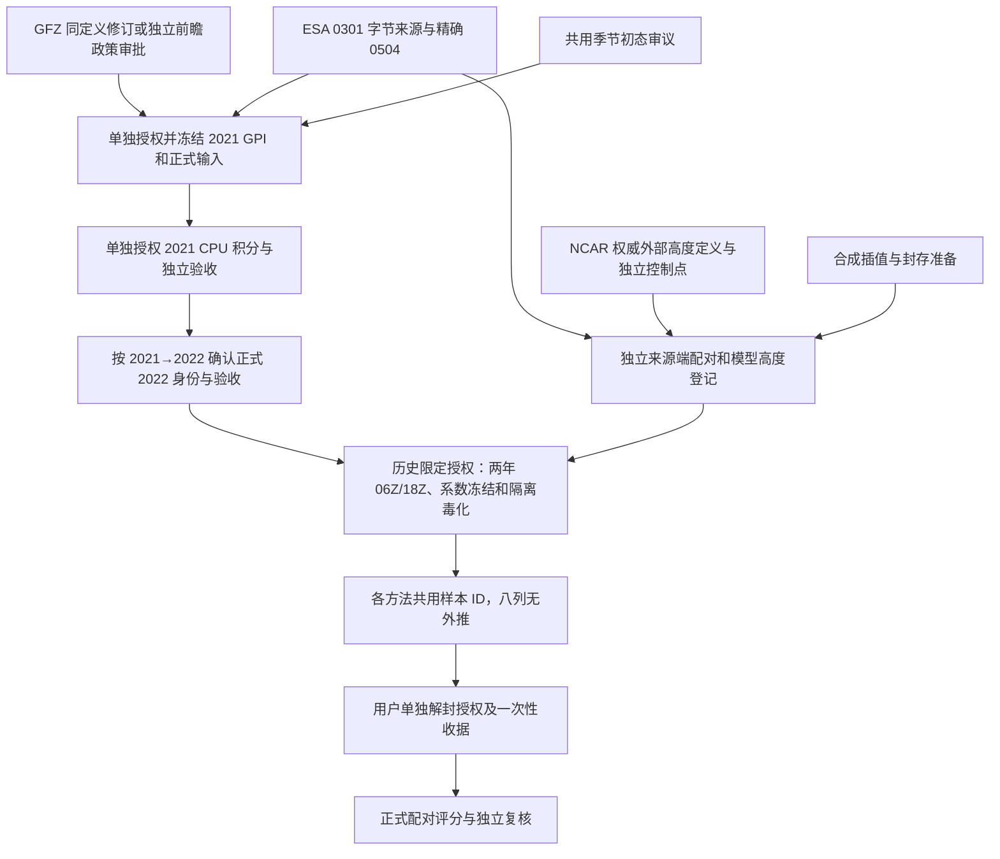

# V55 两年份科学验证依赖

GFZ、ESA、NCAR、季节种子和合成测试可并行。产品来源、2021 驱动和种子审议在正式准备前，2021 工程验收优先于正式 2022。沿轨控制点无需解封密度。内部可先用无标签的样本 ID、时间包围和原生 ZG 检查制备，或用非目标开发数据测试访问边界。两年正式历史计算须单独授权。V51 的 2022 21 天输出仍为工程结果，不能替代 V37 要求的正式身份。标签解封、一次性评分及复核顺序冻结。

## 2021 长期缺测选项

| 方案 | 定义及覆盖变动 | 样本、系统误差与可比性 | 授权 |
|---|---|---|---|
| A 等待同定义 GFZ 修订 | 日期、历史窗口和 Fobs 定义不变 | 只有发布方核实正确时刻、质量和版本后才可用；重核支持日期和输入 SHA | 另准 GPI 生成及积分 |
| B 审议官方异源 observed | 需两天均有可追溯真实观测，并明确新时刻／供应商。任一日无法满足就继续阻塞 | 日值可能系统偏移，影响平滑窗、预热强迫及历史系数；需要事前同定义对照和新输入 SHA。样本 ID 不自动改变，仍需确认可比性 | 标签封存时先获得独立前瞻政策审批，随后独立授权执行 |
| C 独立 2022 探索分支 | 日期集合只剩 2022，另立协议、估计量和工程身份 | 放弃跨年推断和 2021 配对，不能继承 V37 的双年验证结论。当前可仅研究既有 2022 原生模型工程证据，观测访问另行审批 | 另行批准分支及其目标、方法、数据和访问范围 |
| D 维持阻塞 | 原冻结日期、单位、窗口及 GFZ −1 不变 | 继续有价值的非目标工程，例如接收测试、外部配准证据及开发集插值验证 | 本轮推荐 D，并推进 A 的官方咨询 |

GFZ、NCAR 与 ESA 答复只更新证据登记。没有以 Swarm 预测误差挑选替代值的步骤。历史限定访问、合成未来毒化、正式解封及评分都须按冻结协议执行。
