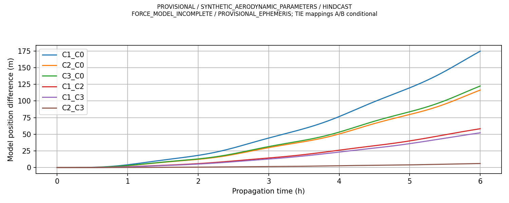
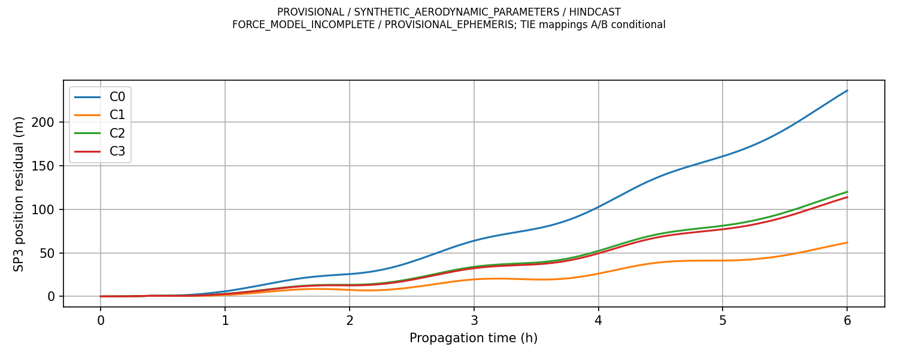
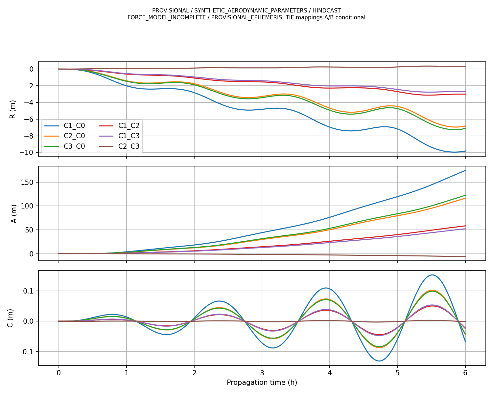
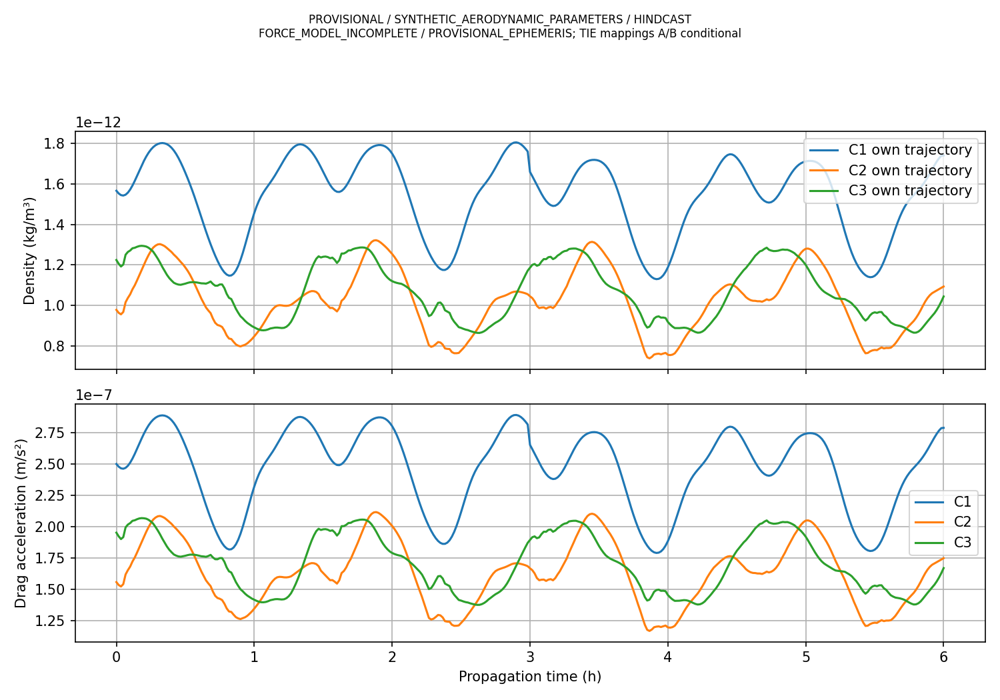
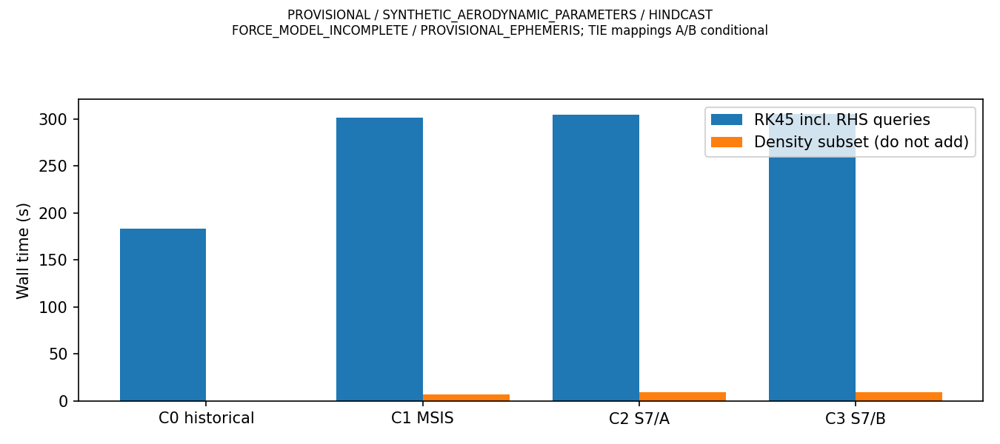

# 第一阶段组会图表索引（2026-10-21）
全部复用真实既有图，不重画、不复制。统一PROVISIONAL / SYNTHETIC_AERODYNAMIC_PARAMETERS / HINDCAST / FORCE_MODEL_INCOMPLETE，星历PROVISIONAL_EPHEMERIS。

## 图1：模型间位移

同背景下密度来源/映射改变六小时传播，不能叫真实预测误差

源图：results/figures/common_density_h6_v1_position_differences.png；SHA256 `bde84b42b93164c3c49c07462b0144d36c19675dd2e9d3dc4299a5e631d8612c`。对应CSV：results/metrics/common_density_h6_v1_*。

## 图2：SP3探索残差

合成参数与未闭合参考面，不按残差排名真实准确度

源图：results/figures/common_density_h6_v1_SP3_residuals.png；SHA256 `ec3431a511a91ebcecd0697f35bbd2bf7d2ca73177a5a48a091bcf1dea64cdce`。对应CSV：results/metrics/common_density_h6_v1_*。

## 图3：RAC方向

同历元C0惯性基底，差异以沿轨为主

源图：results/figures/common_density_h6_v1_RAC_differences.png；SHA256 `e8278496fa3330ab4e952b3e8923068f496dd65b841e64c7e19fef53ee31412f`。对应CSV：results/metrics/common_density_h6_v1_*。

## 图4：密度与阻力

各自预测轨迹上的实时查询，区别于同位置诊断

源图：results/figures/common_density_h6_v1_density_drag.png；SHA256 `944d4d891df7e2b0dccabd9a8ce8ab73b96b25db738e942510efb9439776c6ce`。对应CSV：results/metrics/common_density_h6_v1_*。

## 图5：在线成本

查询是积分子集，不能相加；S7历史离线1382.676s另计且A/B共享

源图：results/figures/common_density_h6_v1_costs.png；SHA256 `3ea1b94d23b742431acccc77aa55e2f5dfeb0bbf216c7fbeb4da4e54b777a92d`。对应CSV：results/metrics/common_density_h6_v1_*。
