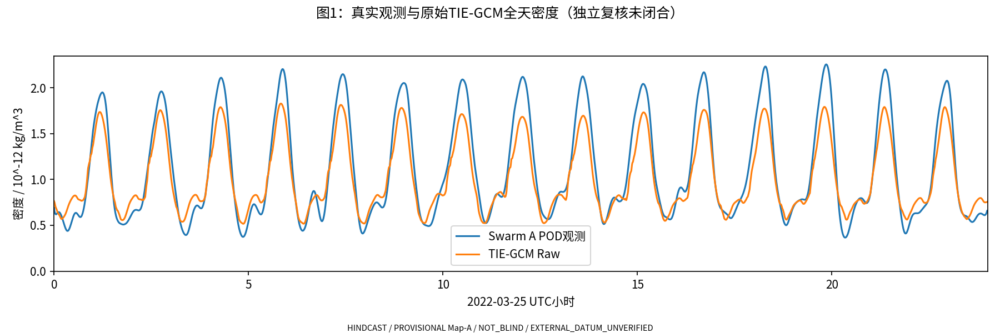
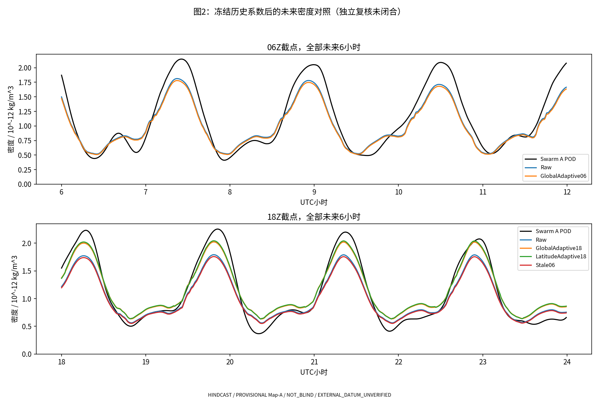
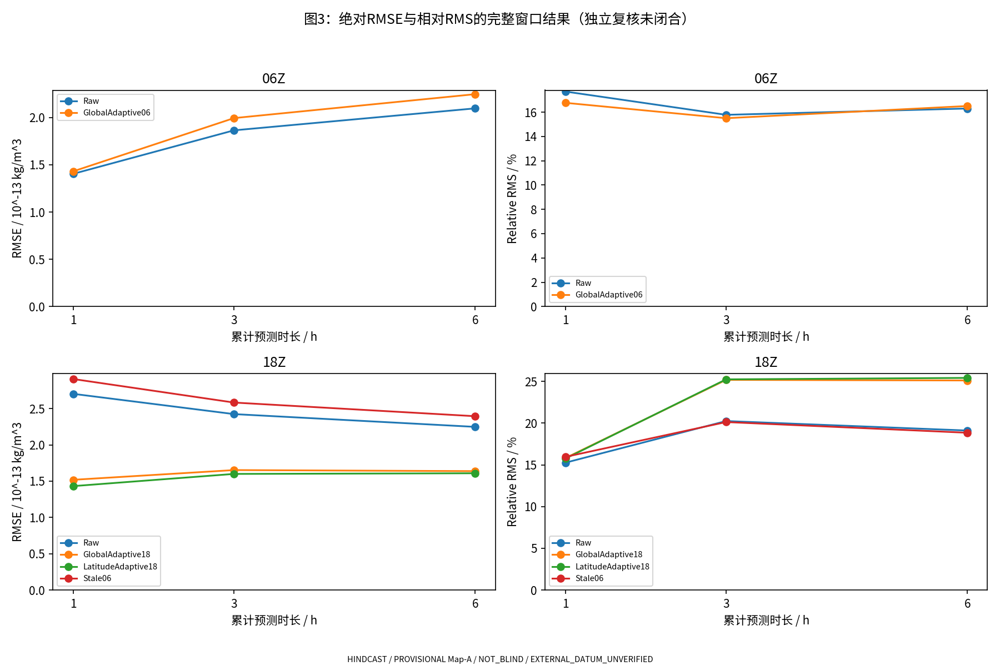
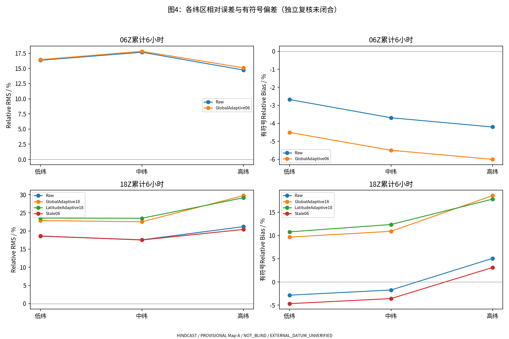
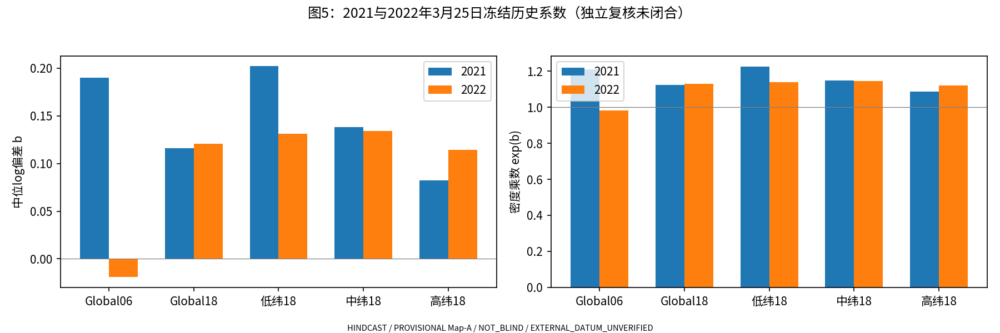
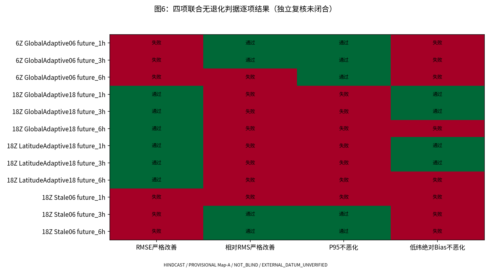
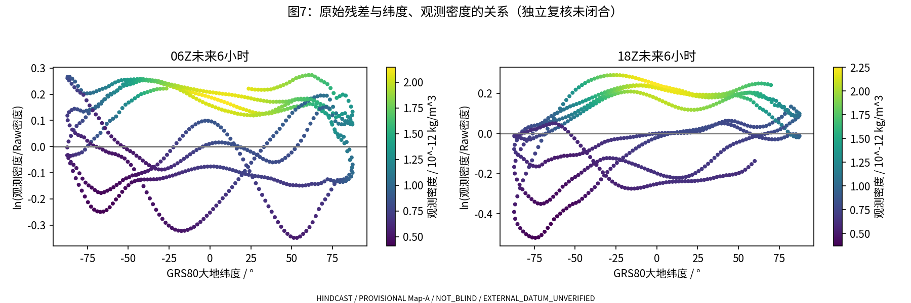

# V18：2022-03-25真实密度误差评价（独立复核未闭合）

**V18=INCONCLUSIVE。唯一一次正式CPU评分已经产生完整指标；独立验证未通过冻结容差，不能标记本轮科学验证PASS。未重跑评分、未修改参数或门槛。**

研究身份：HINDCAST / PROVISIONAL Map-A / NOT_BLIND / EXTERNAL_DATUM_UNVERIFIED。以下数值是已保留的单次主评价输出，尚待独立复核闭环；不将它们包装成获得独立验证的新方法。V17 ENGINEERING_PASS及V16原ENGINEERING_FAIL历史记录保持。

## 1. 数据与执行顺序

起始本地和远端HEAD均为7dd203e6981c87a9c012d189f1bca27656df66f8。使用run_id=094fcac3949c4e2e981d3baac1a5d8bf的新17天冷启动B14，非旧探索性B14。35个模型输出SHA核验一致，目标日原生secondary016/017覆盖00—次日00，共25帧。DEN/ZG保持ilev、g/cm3×1000及cm×0.01，原Map-A和八列规则不改。Swarm A DNSAPOD0301原CDF SHA=d2f647f723f774a446e6c07c9b1108c1dc521b76bb21a2d524d321d379b440a8。

准入只读元数据及SHA，不读未来密度。独立history进程仅切片读取03—06和15—18的瞬时density，各360条，查询对应模型后独占冻结correction_parameters.json。之后另一个score进程才读未来观测；06/18各自复制原始数据进行1e20毒化，历史参数字典逐项完全不变。原协议no_evaluation_or_fitting_this_task是准备任务范围，本轮授权覆盖其范围限制，但原文件及科学参数不变。

在任何校正应用前，先存Raw指标及raw_scoring_receipt；然后计算冻结校正结果。完整观测ID、UTC、位置、flag及逐点匹配只在本地common_sample_ids_local.csv/matched_local.npz，公共coverage.csv保存共同ID的SHA。全日2880/2880 flag0、密度正且有限、质量有效，2880/2880原Map-A查询成功，23040列全检查；不因误差大小剔除点。全天曲线只作描述，不冒充正式截点评价。

历史分段与全天读取的时间原点不同，可有末位插值舍入。启动前解析时间测试已记录implementation_addendum：按原rtol=1e-13,atol=0核对重读值，实际拟合/毒化保留历史阶段原值。未修改小时读取器或插值规则。参数冻结前后的SHA完全一致。

## 2. 历史参数冻结

| 年份 | 区域/截点 | 历史N | b | exp(b) |
| --- | --- | --- | --- | --- |
| 2021 | 06Z global | 360 | 0.189894915247908 | 1.209122530639585 |
| 2021 | 18Z global | 360 | 0.116277697699839 | 1.123307768808366 |
| 2021 | 18Z low | 124 | 0.201977321818866 | 1.223820253779260 |
| 2021 | 18Z mid | 124 | 0.138212340234977 | 1.148219337554280 |
| 2021 | 18Z high | 112 | 0.082286175526193 | 1.085766485168805 |
| 2022 | 06Z global | 360 | -0.018942815080171 | 0.981235472510289 |
| 2022 | 18Z global | 360 | 0.120965466908784 | 1.128585938133250 |
| 2022 | 18Z low | 124 | 0.131223991319031 | 1.140223152798409 |
| 2022 | 18Z mid | 117 | 0.134127169790602 | 1.143538233916052 |
| 2022 | 18Z high | 119 | 0.114488421405905 | 1.121299657915202 |

Stale06精确引用各自同日06Z系数，2022乘数0.9812354725102888，绝不使用3月23/24日参数。18Z三纬区历史N为124/117/119，均≥30；没有fallback。2021表只读既有冻结参数，未重新拟合。

## 3. 原始物理密度误差

| 截点 | 累计h | N | RMSE (10^-13 kg/m³) | Relative RMS % | Bias (10^-13 kg/m³) | relative P95 % |
| --- | --- | --- | --- | --- | --- | --- |
| 06Z | 1 | 120 | 1.4045 | 17.7017 | 0.0976 | 38.1225 |
| 06Z | 3 | 360 | 1.8651 | 15.7830 | -0.6244 | 27.5002 |
| 06Z | 6 | 720 | 2.0978 | 16.3033 | -1.0463 | 27.3307 |
| 18Z | 1 | 120 | 2.7031 | 15.2515 | -1.7721 | 21.4811 |
| 18Z | 3 | 360 | 2.4238 | 20.2464 | -1.1620 | 45.3301 |
| 18Z | 6 | 720 | 2.2478 | 19.1088 | -0.9175 | 35.0441 |

模型相对POD产品的条件性误差，不是绝对真值精度，也不证明ZG外部零面。所有正式1/3/6小时覆盖120/360/720点、质量和共同域覆盖率100%。

## 4. 所有固定方法未来结果

| 截点 | 方法 | 累计h | RMSE (10^-13 kg/m³) | Relative RMS % | P95 % |
| --- | --- | --- | --- | --- | --- |
| 06Z | Raw | 1 | 1.4045 | 17.7017 | 38.1225 |
| 06Z | Raw | 3 | 1.8651 | 15.7830 | 27.5002 |
| 06Z | Raw | 6 | 2.0978 | 16.3033 | 27.3307 |
| 06Z | GlobalAdaptive06 | 1 | 1.4310 | 16.7720 | 35.5307 |
| 06Z | GlobalAdaptive06 | 3 | 1.9947 | 15.5046 | 25.1077 |
| 06Z | GlobalAdaptive06 | 6 | 2.2479 | 16.5086 | 25.3360 |
| 18Z | Raw | 1 | 2.7031 | 15.2515 | 21.4811 |
| 18Z | Raw | 3 | 2.4238 | 20.2464 | 45.3301 |
| 18Z | Raw | 6 | 2.2478 | 19.1088 | 35.0441 |
| 18Z | GlobalAdaptive18 | 1 | 1.5182 | 15.8046 | 29.9276 |
| 18Z | GlobalAdaptive18 | 3 | 1.6523 | 25.1806 | 64.0175 |
| 18Z | GlobalAdaptive18 | 6 | 1.6377 | 25.1090 | 52.4089 |
| 18Z | LatitudeAdaptive18 | 1 | 1.4314 | 15.7411 | 29.0887 |
| 18Z | LatitudeAdaptive18 | 3 | 1.5995 | 25.2423 | 65.8028 |
| 18Z | LatitudeAdaptive18 | 6 | 1.6086 | 25.4166 | 53.3157 |
| 18Z | Stale06 | 1 | 2.9074 | 15.9486 | 22.9544 |
| 18Z | Stale06 | 3 | 2.5829 | 20.1239 | 42.6030 |
| 18Z | Stale06 | 6 | 2.3948 | 18.8438 | 32.5101 |

Raw/校正的MAE、Bias、logRMS、Pearson、最大绝对误差及完整指标见metrics.csv；非重叠块见time_block_metrics.csv，区域见region_metrics.csv，改善/恶化/不变点数见pointwise_diagnostics.csv，均保留不利结果。

### 主评价四项联合判据（尚未独立闭环）

| 截点 | 方法 | 窗口 | RMSE改善% | 相对RMS改善% | 四标志顺序 | 联合 |
| --- | --- | --- | --- | --- | --- | --- |
| 6 | GlobalAdaptive06 | future_1h | -1.89 | 5.25 | 0110 | FAIL |
| 6 | GlobalAdaptive06 | future_3h | -6.95 | 1.76 | 0110 | FAIL |
| 6 | GlobalAdaptive06 | future_6h | -7.16 | -1.26 | 0010 | FAIL |
| 18 | GlobalAdaptive18 | future_1h | 43.83 | -3.63 | 1001 | FAIL |
| 18 | GlobalAdaptive18 | future_3h | 31.83 | -24.37 | 1001 | FAIL |
| 18 | GlobalAdaptive18 | future_6h | 27.14 | -31.40 | 1000 | FAIL |
| 18 | LatitudeAdaptive18 | future_1h | 47.04 | -3.21 | 1001 | FAIL |
| 18 | LatitudeAdaptive18 | future_3h | 34.01 | -24.68 | 1001 | FAIL |
| 18 | LatitudeAdaptive18 | future_6h | 28.43 | -33.01 | 1000 | FAIL |
| 18 | Stale06 | future_1h | -7.56 | -4.57 | 0000 | FAIL |
| 18 | Stale06 | future_3h | -6.57 | 0.60 | 0110 | FAIL |
| 18 | Stale06 | future_6h | -6.54 | 1.39 | 0110 | FAIL |

四标志顺序为RMSE/相对RMS/P95/低纬绝对Bias，1满足、0失败。主表联合0/12，单项19/48满足；未将0/12解释成所有方法在每个指标均无收益。06Z校正三个累计窗口绝对RMSE均恶化，而1/3h相对RMS降低；18Z Global/Latitude三个窗口绝对RMSE均降低、相对RMS和P95均恶化。Stale06绝对RMSE三个窗口均恶化。累计窗口高度相关，禁止作12次独立试验或普通IID检验。

### 纬区结构：未来6h

| 截点 | 方法 | 纬区 | N | RMSE (10^-13 kg/m³) | Relative RMS % | Relative Bias % |
| --- | --- | --- | --- | --- | --- | --- |
| 6 | Raw | low | 221 | 2.4528 | 16.3516 | -2.6776 |
| 6 | Raw | mid | 251 | 2.2737 | 17.6750 | -3.6906 |
| 6 | Raw | high | 248 | 1.4773 | 14.7385 | -4.2035 |
| 18 | Raw | low | 248 | 2.9653 | 18.5874 | -2.8435 |
| 18 | Raw | mid | 248 | 2.0828 | 17.5720 | -1.7377 |
| 18 | Raw | high | 224 | 1.3045 | 21.1971 | 5.0753 |
| 6 | GlobalAdaptive06 | low | 221 | 2.6380 | 16.4565 | -4.5038 |
| 6 | GlobalAdaptive06 | mid | 251 | 2.4284 | 17.8298 | -5.4978 |
| 6 | GlobalAdaptive06 | high | 248 | 1.5813 | 15.1046 | -6.0011 |
| 18 | GlobalAdaptive18 | low | 248 | 1.9454 | 22.8663 | 9.6495 |
| 18 | GlobalAdaptive18 | mid | 248 | 1.4318 | 22.5432 | 10.8975 |
| 18 | GlobalAdaptive18 | high | 224 | 1.4702 | 29.7481 | 18.5865 |
| 18 | LatitudeAdaptive18 | low | 248 | 1.9004 | 23.5558 | 10.7801 |
| 18 | LatitudeAdaptive18 | mid | 248 | 1.4252 | 23.5109 | 12.3667 |
| 18 | LatitudeAdaptive18 | high | 224 | 1.4389 | 29.1570 | 17.8209 |
| 18 | Stale06 | low | 248 | 3.1620 | 18.6182 | -4.6666 |
| 18 | Stale06 | mid | 248 | 2.2340 | 17.5275 | -3.5815 |
| 18 | Stale06 | high | 224 | 1.3559 | 20.4315 | 3.1036 |

18Z低纬Raw relativeBias=-2.8435%，Global后+9.6495%、Latitude后+10.7801%；低纬过校正仍存在。高纬Raw已高估+5.0753%，两个18Z增幅方法推至+18.5865%/+17.8209%，并使高纬绝对RMSE恶化。纬度历史中位数并不足以保证未来各区相对误差无退化。

## 5. 历史代表性与评价目标

| 截点 | 未来窗口 | 历史b_H | 未来b_F（仅事后诊断） | b_F-b_H |
| --- | --- | --- | --- | --- |
| 6 | future_1h | -0.018943 | -0.047096 | -0.028153 |
| 6 | future_3h | -0.018943 | -0.002807 | 0.016136 |
| 6 | future_6h | -0.018943 | 0.091680 | 0.110623 |
| 18 | future_1h | 0.120965 | 0.125416 | 0.004451 |
| 18 | future_3h | 0.120965 | 0.044905 | -0.076061 |
| 18 | future_6h | 0.120965 | 0.034614 | -0.086351 |

06Z到6小时未来中位数由负转正，历史代表性有限；18Z首小时中位数接近历史，但相对误差仍恶化，说明代表性不是唯一因素。RMSE²=mean(obs²×relativeError²)，相对RMS²=mean(relativeError²)，中位log残差估计器与这两个目标均不等价。高密度区域绝对误差改善可能掩盖相对误差损失；本轮不另拟合或用未来中位数生成预测。不能仅凭沿轨统计把模型空间误差、轨道采样、POD反演偏差及高度基准分别归为已验证因果来源。

## 6. 2021年冻结B14只读对照

| 年份 | 截点 | 方法 | 6h RMSE (10^-13 kg/m³) | 6h Relative RMS % | 6h Bias (10^-13 kg/m³) |
| --- | --- | --- | --- | --- | --- |
| 2021 | 6 | Raw | 1.2799 | 22.8144 | -0.4478 |
| 2021 | 6 | GlobalAdaptive06 | 1.1155 | 34.1249 | 0.4228 |
| 2021 | 18 | Raw | 1.1677 | 18.6351 | -0.6115 |
| 2021 | 18 | GlobalAdaptive18 | 0.8819 | 20.3057 | -0.1436 |
| 2021 | 18 | LatitudeAdaptive18 | 0.7580 | 21.6538 | -0.0108 |
| 2021 | 18 | Stale06 | 0.8096 | 24.9045 | 0.1820 |
| 2022 | 6 | Raw | 2.0978 | 16.3033 | -1.0463 |
| 2022 | 6 | GlobalAdaptive06 | 2.2479 | 16.5086 | -1.2368 |
| 2022 | 18 | Raw | 2.2478 | 19.1088 | -0.9175 |
| 2022 | 18 | GlobalAdaptive18 | 1.6377 | 25.1090 | 0.4038 |
| 2022 | 18 | LatitudeAdaptive18 | 1.6086 | 25.4166 | 0.4858 |
| 2022 | 18 | Stale06 | 2.3948 | 18.8438 | -1.1103 |

2021冻结B14联合1/12（仅18Z纬度首小时），2022单次主表0/12且尚待独立复核。2021/2022早晨b分别+0.189895/−0.018943，方向相反；晚间+0.116278/+0.120965相近，仍不能保证相同联合收益。两年18Z 6h纬度校正均表现为绝对RMSE降低而相对RMS升高。未证明稳定跨日期收益。两背景分别连续积分，均03-09冷启，06/18截点实际暖态历时16.25/16.75天；B14是候选背景身份，不是多变量充分收敛认证。同为3月有限相邻日期，不支持全年、全球或跨季节泛化。

## 7. 测试与独立复核故障

33项既有CPU回归全部通过：纬度14、晚间11、小时算子8。数据准入、历史与未来隔离、两个独立毒化输入、参数SHA、35卷SHA和旧结果保护均通过。独立程序直接读取CDF、25帧原生数据、2880点独立八列重构，所有先行断言通过；五个系数及exp(b)在冻结门槛内。

独立数值循环在18Z LatitudeAdaptive18的**历史analysis Bias**停止：主5.453772204284436e-16，复算5.453772204285187e-16 kg/m³，绝对差7.51e-29，约1.377e-13相对差，超过rtol1e-13/atol0。没有把它隐瞒为未来指标失败，也没有因为差小而绕过门槛。

独立复算使用math.exp，中纬乘数1.1435382339160527；冻结科学实现numpy.exp及冻结乘数为1.1435382339160525，相差1ULP。极小、近抵消的Bias对这次末位差敏感。只对该失败历史行作诊断，按原冻结乘数计算得到主值逐位一致；这不是重新评分或将独立FAIL改为PASS。主评分及参数均未更改，未再执行verify/score入口。独立循环尚未完成所有后续指标和联合判定，因此**整体INCONCLUSIVE**，不能宣布独立复核通过。

完整失败stdout、原始告警和查询轨迹本地保留；50条全天已知NetCDF告警按V17来源SHA通道记录，不修改原始属性或屏蔽真实数值问题。图表由已生成的一次性结果绘制，均注明独立复核未闭合；首次字体不含上标负号的草图移至本地，最终使用ASCII幂次单位，不重算科学结果。

## 8. 资源、版本与后续

唯一正式评价监督耗时11.810303秒，采样树峰RSS346.887MiB，直接wait返回1，qualification=FAIL，原因为复核断言；无超时/资源超限/采样缺口，清理完成。不是模型积分失败。后续仅失败诊断、图表和文件整理，不重复评分。来源、时间、共同样本哈希和代码SHA见source_manifest/frozen_protocol/parameter_freeze_receipt/sha256_manifest；最终资源汇总见resource_audit.json。

下一轮建议只读闭合独立复核：使用已冻结乘数作独立指标算术，exp实现差异单独以冻结门槛验证；不重新拟合、不修改科学指标、不同意放宽容差或重选窗口。当前不自动执行该复核。闭合后再讨论增加真正独立季节/活动条件的观测与合法物理场，优先评价固定方法的适用边界，不直接加参数。ZG物理登记仍需正式证据；数学/工程有效率不能替代它。DART/Restart/真实气动与轨道门禁未闭合。

继续保持SCIENCE_TRAINING_READY=False、EXTERNAL_DATUM_UNVERIFIED、Restart=FAIL、DART=NOT_ADMITTED、REAL_ORBIT=BLOCKED。未启动TIE-GCM/GPU/DART/AI/轨道、未下载数据或外部联系。本轮整理后停止。

## 图表及解释

### 图1：真实观测与原始TIE-GCM全天密度

全天曲线仅作描述，正式指标按固定截点未来窗口分别报告。

### 图2：冻结历史系数后的未来密度对照

校正参数仅取各自历史3小时；局地系数按未来样本自身原始大地纬度应用。

### 图3：绝对RMSE与相对RMS的完整窗口结果

RMSE在原始密度尺度计算；相对误差逐点除以观测密度，二者权重不同。

### 图4：各纬区相对误差与有符号偏差

分区仅用原始GRS80大地纬度。正Bias表示高估，负值表示低估；包含全部共同样本。

### 图5：2021与2022年3月25日冻结历史系数

2021参数只读引用，Stale06精确复用各年同日Global06；未跨年迁移系数。

### 图6：四项联合无退化判据逐项结果

绿色满足，红色失败；同一行四项全部满足才记联合PASS，累计窗口相关，不能视作独立实验。

### 图7：原始残差与纬度、观测密度的关系

空间采样、高度和密度变化相互关联；图中相关性不是已分离的因果贡献。

## 领导汇报（300字以内）

已用工程验收通过的2022年3月25日物理场与2880条Swarm A实测完成一次固定协议评价，历史参数冻结和防泄漏测试通过。晚间全局、纬度校正虽降低绝对RMSE，却扩大相对误差及尾部误差，主表联合无退化0/12，不支持稳定跨日期收益。独立复核在近零历史Bias因指数函数1ULP差异超出冻结容差，已停止且未放宽门槛，整体暂为INCONCLUSIVE。建议下一轮只读闭合复核，再扩展独立日期；不启动同化、AI或轨道。
