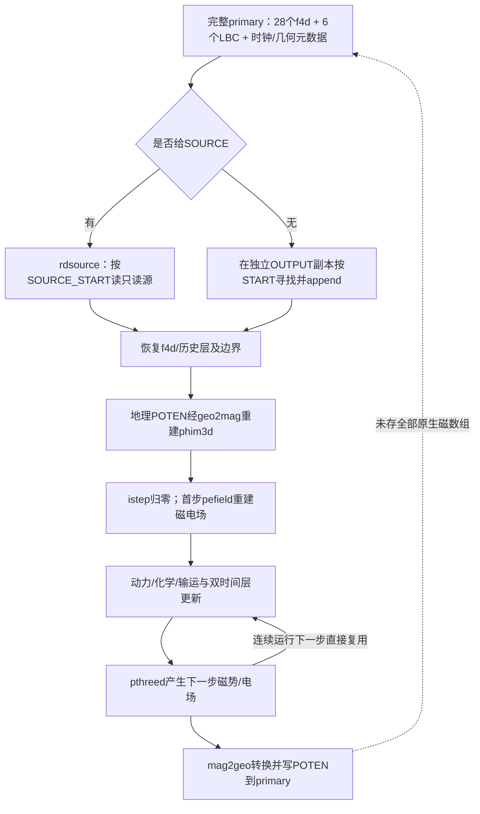

# TIE-GCM运行时状态恢复审计与极短2021对照

日期：2026-10-30。独立标签` tiegcm_runtime_restart_audit_v1 `。本轮不进行远端同步。

## 1. 结论

**RESTART_RECOVERY_READY=FAIL。**同一2021合法完整状态起算的20分钟连续轨迹，与10分钟后按原生primary恢复再积分10分钟的轨迹，终点34项标准状态中28项超出原冻结容差，9项核心secondary全部超差。六项LBC及其_NM通过。补充24项共同数值场按预注册严格相同检查，6项相同、18项不同。

模型均正常退出不等于恢复一致性通过。第一阶段失败后，第二阶段插桩构建/运行和第三阶段过程预算积分均为0；不以静态设计代替实测PASS。原122帧与scientific_training_READY=false保持。

## 2. Git、环境和原始数据

开始时本地HEAD、远端main均为`a53ce69646eb8a49e797777af98c57753f1f7ef7`，工作区干净；用户描述的不同步已由实际核对更新。不执行reset/clean/rebase/push，保留本地原提交。

复用项目内TIE环境、原同一exe，不重新编译。exe SHA为`f60832a66caf7f95d5de8e7aafa44f0b6981ae38d130fe237b9df28fdf896776`；实际Make.env规定当前构建目录优先，其后原src。Make.workspace为GNU12、`-fdefault-real-8 -fno-range-check -O2`，nchist单文件增加原F77兼容参数；原官方apex覆盖层及已有GNU兼容覆盖保持不变。NPROC=1是原Make.env构建字段，**本轮实际运行是4 MPI rank**，不能据该字段误判串行。

有效Srcfiles共97个编译源码，逐一按构建搜索顺序定位并记录SHA，见effective_source_manifest.json；不是把原第三方树假装成未打任何构建补丁的可执行文件。未升级库、未改变物理开关、未修改原源码、无GPU任务。

原始A14/B14全部NetCDF、原候选NPZ、有效exe/GPI/apex/编译配置、原源文件和已有科研交付进入保护清单；读后**2346项文件SHA一致**。完整protected_files.json只读清单与最终integrity_and_resources.json保留。大NetCDF不拟公开上传。

## 3. 状态审计范围与证据表

`results/tiegcm_runtime_restart_audit_v1/runtime_state_audit.csv`提供**107行**审查表，列出Fortran实际变量名、文件/子程序/行号、物理意义、网格、维度、单位、状态类型、是否持久化、是否可准确重建及缺失影响。标准34状态逐个列出，不只合并成“温度/风”。文件维度与运行时带halo/双存储槽维度分开。

另生成97个有效源码的模块声明及显式SAVE/DATA搜索索引，共516条声明候选，供继续审查。**这不是完整全程序跨步活跃性证明**；可能包含未启用CPP分支或不跨步的工作数组。未确认生命周期/单位的条目显式保留“未完全资格验证”，不能声称所有隐藏状态已穷尽。

### 3.1 标准状态与双时间层

`fields.F:19–21,59–75,154–158`定义30个f4d，其中28个写primary。字段最后两个存储槽itp/itc是执行缓冲；TN_NM等又保存滤后的上一时间层，不能将槽2简单等同_NM。

标准primary为18当前场、10个_NM、6项LBC及_NM，共34。当前物种包括O1/O2/He/AR、NO/N4S、离子等；化学历史缓冲并非全部缺失，已有NO_NM/N4S_NM/OP_NM等必须保留。`chemrates.F`的温度依赖速率和fs矩阵则按每纬度每步重算，不应仅因不持久化就判为缺失独立预报状态。

N2由addiag和comp中`1−O1−O2−He`得到，DEN实际Fortran工作量为dt.F中的rho，ZG由calczg得到，均为诊断；它们在secondary存在不意味着可以代替完整primary。

### 3.2 四个关键内部磁坐标数组

|名称|声明/分配/更新|维度与生命周期|单位与恢复问题|
|---|---|---|---|
|phim3d|pdynamo.F:48–55、1180–1182；pthreed；define_phim3d|SAVE allocatable；(mlon0:mlon1,mlat0:mlat1,mlev0:mlev1)；分配清零，后续pthreed更新|V；输出时mag2geo为地理POTEN，恢复时geo2mag回映射，未证明无损互逆|
|ephi3d|同模块1189–1191；pthreed/首步pefield|同上；连续步读取上一pthreed结果，首步另重算|是坐标尺度的电势导数组件，不应直接标为物理V/m|
|elam3d|1192–1194；pthreed/pefield|同上，分配清零，随后含纬度度量的电势梯度|与ephi3d类似，真实电场需后续几何换算|
|emz3d|1195–1197；2511–2518、2703附近|同上；磁垂直层电势差，顶/底有边界复制|原式为电势差，不能把原数组直接叫V/m|

关键单位证据是`ionvel.F:72–95`：重映射后的ex/ey还要除以re+z，ez除以相邻垂直高度差，局部eex/eey/eez才标V/cm。因此“电场数组”这个名称不能替代原生量纲审查。

实际文件有地理格lat36/lon72/lev29/ilev29，磁格mlat97/mlon81/mlev32/imlev32。运行时局部数组另有halo与MPI分块，不能直接拿地理POTEN数组当磁坐标数组逐元素写回。四数组在原A14/B14 primary和本轮新primary中均未直接序列化，无法给出其真实连续/恢复差场或SHA。

另需区分fields_module中的同名phim3d/emz3d和emphi3d/emlam3d旧全域数组（fields.F:132–136，nodynamo分支），它们不是本轮有效pdynamo_module的局部SAVE数组。my_esmf的mag/geo_*字段是独立ESMF对象，也不能替代原生物理数组的无损恢复。

此外ed13d/ed23d/zpotm3d、导电率/求解缓存及几何重映射对象也是需分类的候选，不能因为列出四数组就宣称全状态恢复方案已完备。

### 3.3 其他关键类别

- GPI：gpi.F的gpi_iyd/flux/Kp表从同SHA文件reload；按同绝对日历计算插值。本轮检查记录点的f107d/f107a/Kp/hpower/ctpoten与独立GpiDriver最大差小于1e-10，实际最大见comparison.json。此处未跨3小时桶或日界，不能外推所有边界情形。
- 潮汐：gswm.F首步读入月/小时参考表，再按日历插值；相同GSWM文件及TLBC/ULBC/VLBC状态须保留，不能把缓存重新加载本身认定为误差来源。
- 过滤：filter.F的trigs/ifax由setfft重建；cons.F的kut/shapiro/dtsmooth按同配置初始化；滤波后_NM是需要保存的物理积分记忆。FFT系数不是可任意拟合的自由参数。
- 平流/扩散：halo交换、hdif1/2/3中间系数、comp的三对角求解工作量按调用顺序生成；是否跨步取用需要实际读写关系审查，不能将全部局部临时数组列为restart必需字段。
- 时钟：iter及year/day/ut有持久化；istep每次启动重新从0计数，使首步控制分支重现。相同UTC不意味着istep控制路径相同。hist的文件编号、nhist等是控制状态，须区分纯I/O与实际影响后续计算的分支。

## 4. 原生重启的数据流

SOURCE是合法完整初场读取入口；不提供SOURCE时才走原生continuation并从OUTPUT读。两者不是把任意secondary改名就能启动。`input.F`对SOURCE_START和START小时/分钟约束继续保持。本轮续算使用模型自己生成的00:10完整primary副本，无伪造时间、_NM或未来记录。

primary是**模型支持的标准恢复载体**，但本轮实测它不等价于此配置下的全部运行时状态快照。不能因为文件包含34项就宣称可无损恢复，也不能把缺失数组用零填充冒充恢复。

## 5. 实验设计与执行

共同输入是原A14/primary_015.nc，2021-03-23 00:00，34项float64、iter118080。它作为数值初态建立新的极短资格轨迹；**不是声称复现旧A14整个历史，也不是新的B14分支试验**。

- C连续：00:00→00:20，20步。
- S前段：同一输入00:00→00:10，10步。
- R恢复：将S完整primary按SHA复制到独立目录，删去新namelist的SOURCE/SOURCE_START，通过原生OUTPUT从00:10→00:20，10步。

共3次必要短启动、40步实际新积分。C和S在00:10前使用同源、同驱动、同物理、同输出时刻和4MPI；其STOP/终止调度不同是比较中不可消除的控制差异，不能假装namelist全文相同。R仅改变合法恢复所必需的START/STOP/OUTPUT使用方式。编译器、exe、STEP60s、GSWM/HEELIS/apex/GPI始终相同，无新源码或补丁构建。

预注册protocol在启动前写入：最多3启动、每启动60秒/总模型180秒、RSS16GiB、新增512MiB、单文件256MiB、余盘20GiB，不自动重试。实际：

|运行|步数|墙钟秒|采样MPI树RSS MiB|退出|
|---|---:|---:|---:|---|
|C连续|20|3.323357|868.09|0，4 NORMAL EXIT|
|S前段|10|2.182291|860.17|0，4 NORMAL EXIT|
|R恢复|10|1.991724|858.93|0，4 NORMAL EXIT|

模型墙钟合计7.497372秒，新增NetCDF168,017,388字节（160.23MiB），均未触监督上限。RSS为采样树求和，可能重复计算共享页/遗漏瞬时峰值，不冒称独占RAM精确值。

## 6. 数值比较与误差量级

### 6.1 中断前控制比较

C与S的00:10，34项中6项位级相同、28项有末位差；全部满足原冻结逐点数值容差，最坏归一化误差0.787726（≤1）。TN最大差2.84e-12K、O1约7.33e-15mmr、POTEN约4.35e-9V。带mask、单位换算的逐变量证据在pre_split_prefix.csv。

这些量级与并行归约/浮点运算次序敏感性相容，但本轮没有串行或额外重复对照，**不能唯一断言是MPI非确定性**，也不能宣称位级相同。实际续算终点差异远大于这个控制背景及原容差，不能简单当成同量级舍入噪声忽略。

初版离线比较脚本误用`assert bitwise`要求控制前缀位级相同，故分析停止；模型3次均已完成。保留原脚本、原失败日志和SHA，使用独立只读分析脚本按原protocol所引用的冻结数值判据完成分析，同时保留位级False。**未修改容差、未把整体FAIL变成PASS、未重跑任何模型。**见analysis_incident.json。

### 6.2 恢复后终点00:20

|变量|来源|最大绝对差（SI/mmr）|RMS|
|---|---|---:|---:|
|TN|primary|0.214774K|0.0185284K|
|UN|primary|0.615428m/s|0.0482273m/s|
|VN|primary|0.945317m/s|0.0725360m/s|
|O1|primary|1.97465e-4mmr|1.19469e-5mmr|
|O2|primary|1.19177e-5mmr|7.75099e-7mmr|
|HE|primary|1.12750e-4mmr|3.74109e-6mmr|
|POTEN|primary|6.802985V|2.202699V|
|DEN|secondary|5.38805e-12kg/m³|3.03354e-13kg/m³|
|ZG|secondary|254.28m|12.31796m|
|N2|secondary|2.77160e-4mmr|1.30127e-5mmr|

所有34核心primary和9核心secondary采用**既有**SI atol及float64 rtol1e-10/float32 rtol1e-6。UN/VN参考接近零时相对最大差可很大，须连同绝对差报告，不据此称风场发散。N2近small处同理；本轮没有改分母或small。

核心28+9项失败，只有6项LBC及_NM通过；24项补充共同场按事前精确相同条件得到6项相同、18项不同。补充项的零容差有差异时归一化误差为Infinity，是数学上严格相等判据的结果，**不是原始模型场出现Inf**。

原continuation副本00:10的34状态记录在append后保持位级不变，排除拷贝损坏/在旧原文件上append。两个终点文件SHA均不同，但全文件还有记录数、write_date和run_type等差异，所以文件SHA不同不是单独的物理误差证据。真正判定依据是同UTC变量比较。终点纬度/层差图来自新原始数据，保存在restart_endpoint_difference.png。

## 7. 可以归因什么，不能归因什么

已证实：同一exe/网格/驱动/时间下，标准primary原生continuation不能满足冻结恢复一致性；拷贝、时间、驱动和初始34状态保存检查通过。存在未直接序列化的原生磁势/电场以及重建/首步不同路径，这是直接源码证据。

尚未证实：四数组是否是**全部或唯一**根因；每个内部数组对后续场差异的份额；其他缓存/输出调度/并行取值差异的独立贡献。未新增内部探针，因此不能声称比较过未观测四数组的真实连续/恢复值，更不能在失败后进入插桩组做归因。

## 8. 决策与下一步

|门禁|判定|严格含义|
|---|---|---|
|RESTART_RECOVERY_READY|FAIL|本次同配置极短2021对照实测超差|
|INSTRUMENTATION_INVARIANCE_READY|PARTIAL|仅有静态方案；因上游FAIL未编译/运行插桩，不是数值部分通过|
|STEPWISE_BUDGET_READY|PARTIAL|已有方程设计，实际逐步预算未执行，贡献及闭合R不可评价|
|SCIENTIFIC_TRAINING_READY|FAIL|科学数据放行条件未满足；并非本轮训练失败|

下一步不是继续延长预热，而是另行明确“恢复诊断”的隔离构建协议：在读入、geo2mag、首步pefield、pthreed边界观察内部数组，先定位首次分歧，必要时设计完整运行时序列化。旧checkpoint缺失的状态不能事后凭空造出；新格式须用短连续/分段配对验证，保持物理方程与阈值不变。本轮不自动追加第4次启动或修复补丁，不重跑A14/B14，不训练。

## 9. 交付与复现边界

- `scripts/run_tiegcm_runtime_restart_audit.py`：一次性prepare+3短启动；同标签存在时拒绝覆盖。原初版比较断言记录保留，**不要未经新授权重放模型**。
- `scripts/analyze_tiegcm_runtime_restart_audit.py`：独立只读数值复核，未改冻结门槛。
- `scripts/audit_tiegcm_runtime_state_inventory.py`：有效源码与运行时状态表。
- `results/tiegcm_runtime_restart_audit_v1/`：状态表/搜索索引、完整67行终点比较、34行前缀比较、SHA/资源/保护审计、图和门禁。
- `experiments/tiegcm_runtime_restart_audit_v1/`：冻结protocol/namelist/规则、3组独立NetCDF、每次launch_once及run_status；大型原始输出留本地。
- `logs/tiegcm_runtime_restart_audit_v1_*.log`：原运行/原失败分析/独立复核/源码审计/新配置测试。
- 本轮只执行6项新增配置/门禁测试，通过；按要求未重复旧7项CPU预算测试。
