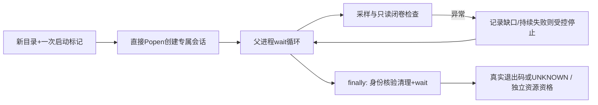

# TIE-GCM监督故障定位与修复

本轮仅短时Python子进程和只读数据审计，真实TIE-GCM启动0。不修改历史监督脚本/第三方模型，不重跑A14，不启动B14。

## 已证实的故障链

1. `scripts/run_tiegcm2023_crossday.py:54–61`中，try仅包住`read_text`等循环体；第56行`Path('/proc').glob('[0-9]*/stat')`的迭代器推进发生在try外。实际Traceback从pathlib.exists/stat抛ProcessLookupError，目标是/proc/1797841/stat，而不是MPI主PID1794822。
2. `scripts/run_tiegcm_2021_14day.py:170–201`启动独立会话后，在172行采RSS，异常越过整个while及201行`proc.wait()`；没有外层try/finally保护子进程所有权、清理和退出记录。2022隔离适配沿用了此路径。`logs/tiegcm_2022_14day_A14_supervisor.log`是直接证据。
3. pair的subprocess.run(check=True)因此收到监督器异常而退出，但不是模型返回码。`start_new_session=True`且未执行进程组终止，使原MPI继续运行；历史guardian记录和连续输出支持此事实。
4. guardian是后来附着的观察者，不是原MPI父进程，没有原Popen.wait持有的直接子进程等待关系。/proc zombie exit_code只有在可观察窗口内才可能读到；实际记录raw status=null、launcher_disappeared_without_observable_exit_status，不能将预设launcher_exit_source文字当作观察成功。
5. resume在A14资格断言处停止，B14启动0。这是原门禁实际生效，不能绕过。

## 推断与不可恢复项

Linux进程被回收后，当前/proc同PID可能是另一进程，不能用其状态追认历史运行。guardian未观察到zombie的具体微秒级先后没有记录；“被系统回收而错过观察窗口”符合机制与现有记录，不是假装有waitpid证据。项目现存日志/状态/清单未发现其他可靠退出记录；历史真实退出码、缺口内逐时RSS和最终waitrusage不可从留存证据恢复。NORMAL EXIT及完整文件不能代替退出码。监控异常不是模型数值异常的证据。

## 新实现

`src/runtime/supervisor.py`不含TIE物理或年份源码替换。直接Popen启动、父进程wait回收；所有采样、解析、验证异常有独立处理，finally再次等待/清理。正常0、非零、信号、超时、启动异常、UNKNOWN分别记录；rc已知与监控资格分别记录，采样缺口不插值。

/proc采用一次列出PID名、逐PID捕获预期竞态；读取stat前后比较出生ticks，选取同UID的专属新session，保留PID/start_ticks/PGID/SID。目标不可读返回RSS=None，不把缺失当0。无关PID瞬逝计数记录。终止时先开pidfd固定进程，再复核出生身份及会话，拒绝复用PID/异UID；对整个已核实会话逐进程TERM/KILL，且真实wait退出码仍保留。不依赖未经验证的killpg数值PID回退。

当前Python3.10未导出pidfd接口，系统libc的pidfd_open/pidfd_send_signal可用；实现显式ctypes签名与errno检查，实测通过。首次测试暴露此兼容性问题，失败日志保留。随后测试还发现验证回调失败计数提前清零，已移到全部采样/校验成功后重置；不放宽测试。

资源控制含单调墙钟、RSS、余盘、单卷NC大小、组输出/总输出、追加日志异常/停滞和闭卷验证回调。事件JSONL逐条flush/fsync；日志写失败也不跳过子进程等待。资源是离散采样，不是瞬时RSS上界。CPU是本监督进程RUSAGE_CHILDREN差值，不是系统总CPU或保证所有已逃逸孙进程均被计入。

## 验证范围和边界

23项实际短子进程/故障注入测试通过，覆盖A—H、PID复用/异UID拒绝、未知RSS、原生信号、监督器SIGTERM、错误日志、验证回调异常和禁止覆盖。不是16天或真实MPI端到端验收。测试使用同服务器本地session；远程MPI、主动逃逸session的守护进程不在当前支持范围。未来仅允许本机4MPI/OMP1并核对实际拓扑。

父监督器遭SIGKILL、主机断电、内核故障或存储永久阻塞，不能承诺还能写最终JSON或回收状态；必须UNKNOWN/PARTIAL，不能宣传软件可保证所有故障下退出状态。墙钟检查与TERM/KILL清理有有限调度/清理开销，未来4800秒总预算须为清理留余量。独立外部watchdog可作为未来增强，但本轮不以旁观者替代直接父进程wait。

## 对既有工具的取舍

还审查了supervise_tiegcm2023_s3.py与supervise_fourcastden_training_smoke.py：S3接管当时保留并最终恢复原父监督器，和本次原父进程已经异常退出不同；不能把那次可恢复父wait的方式套用于历史A14。旧AI工具包含独立的GPU逻辑，未挪用为CPU/MPI资源证明。新模块复用既有预算/日志/闭卷验收约定及物理检查回调接口，不沿用不安全/proc迭代或年份字符串替换管理子进程。历史代码全部保留未改，未来B14不得再走旧监督器入口。
